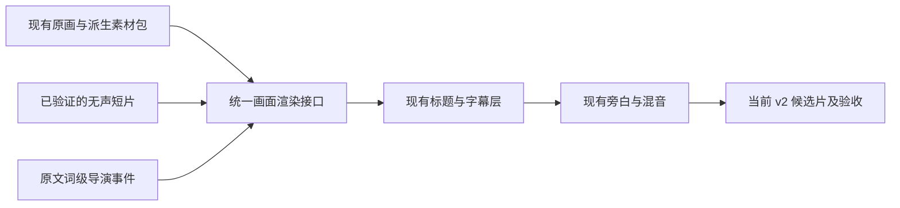

# hv 画面动画升级审计与实施方案

日期：2026-10-18。范围：当前 v2 源码、xlc-01 的 84 秒改善样片、相关官方项目文档及模型卡。本轮完成只读检查与方案研究，没有改动生产实现、安装模型或调用生成服务。源码与样片指纹见 [local-evidence.json](/D:/hv/state/research_animation_upgrade_20261018/local-evidence.json)。

**推荐采用“原画分层与环境微动为主、叙事图形按需出现、生成视频只用于少量关键动作”的组合。** 先让画面中的空间、环境与信息发生变化，保留原画笔触、人物和旁白；现有时间轴与渲染证据链继续使用。

## 现在还有哪些提升空间

| 当前观察 | 对观感的影响判断 | 建议处理 |
|---|---|---|
| 84 秒改善版已有 16 镜头、5 原画、5 标题卡，画面仍是整图裁切与缩放 | 节奏比原版清楚，但前景、人物、背景始终一起移动，容易看出是静态图 | 为少量主场景增加 2–3 层空间运动 |
| 窗外阴雨、灯火、宫室等没有各自的动态层 | 画面没有环境流动，情绪主要依赖声音 | 雨只在窗外、烟雾只在远景、光照只作用于烛台周围 |
| 托付、权力束缚等机制仍主要靠旁白说明 | 多个人物和政治关系不容易被一次看懂 | 在相关词出现时，依次揭示人物标签、关系线或权力流向 |
| 首帧文字可读，但标题、副标题、集数占据较大上方区域 | 包装层和人物画面争夺注意力 | 主句 t=0 完整出现；副信息精简，装饰线短暂运动后退场 |
| 后续重点仍多用标题卡提示 | 文字变化多于画面内的事件变化 | 每个段落先确定视觉任务，再选动画；不要求每句都动 |

这些是基于当前样片抽帧与实现的创作判断，不是留存率实验结果。本轮没有逐集扫描历史内容，也没有证明任何动画必然提升播放量。

实现上的缺口很明确：[_encode_v2_segment](/D:/hv/app/services/production_v2.py:161) 读取一张图片，计算裁切并贴上文字；没有视频帧或分层场景入口。[video 配置](/D:/hv/app/config/config.yaml:257) 为关闭状态，API 只有 relay 状态，不能通过切换 enabled 就得到图生视频。已有 [导演事件](/D:/hv/app/services/directing.py:48) 可以继续作为动画触发入口。

## 推荐的四类动画

| 优先级 | 类型 | 在画面中发生什么 | 适用场景 | 主要成本或限制 |
|---|---|---|---|---|
| 第一批 | 局部环境与信息进入 | 雨丝、低密度烟雾、局部烛光；短线条、遮罩揭示和标签进入 | 阴雨、宫室、战场远景、首帧与幕间提示 | 需要可信的区域蒙版；不能让雨穿过室内人物，也不宜全画面闪动 |
| 第一批 | 2.5D 分层视差 | 前景柱/帘、人物整体、背景以不同幅度移动，产生景深 | 宫殿、书案、城门、人物与群臣 | 人物移开会露出原图没有的背景，需要补洞或限制运动范围 |
| 第二批 | 叙事解释动画 | 人物关系按旁白出现，路线逐段延伸，时间线或数字变化 | 顾命大臣、阵营变动、行军、疆域、财政机制 | 必须绑定原文与可靠的地理/史实依据；保持现有字体、色板和绘图语言 |
| 第三批 | 少量图生视频 | 旗帜、衣袖、环境或人物的小动作 | 少量需要真实动作的 3–5 秒关键镜头 | 人脸、手、冠饰、背景和画风都可能漂移；生成成功不等于可用 |

一镜以一个主要动作作为注意力中心。安静镜头可以保留静态；“不是倚仗”这样的转折处，运动减弱或短暂停住也能形成强调。转场优先使用构图、视线或动作方向衔接，少量淡化服务段落，不增加与叙事无关的炫技。

**分层必须保形。** 人物头、脸、手和身体先作为刚性层；交握的双手合为保护区域。首轮不做面部网格扭曲、自动眨眼、呼吸变形或重新生成握手。相对视差可从画幅宽度的约 0.5%–1.5% 开始试调；这是样片参数起点，不是行业质量标准。

## 查询到的项目与选型

以下区分官方能力与本项目的采用建议；没有安装实测。

| 项目 | 官方能力与许可要点 | 本项目建议 |
|---|---|---|
| [Depth Anything V2](https://github.com/DepthAnything/Depth-Anything-V2) | 单图深度估计。代码与 Small 权重为 Apache-2.0；较大权重另有非商业许可 | Small 可作离线远近关系草稿，每张图只预计算一次；不把估计深度当真实三维结构 |
| [SAM 2](https://github.com/facebookresearch/sam2) | 可提示分割，主要代码及权重为 Apache-2.0 | Tiny/Small 作为可选蒙版助手；人工修边。它不能补出人物背后的背景 |
| [DepthFlow](https://github.com/BrokenSource/DepthFlow) | 图片＋深度的视差渲染；当前代码 AGPL-3.0 | 独立小样参考工具，优先试宫殿/山水；不把其代码按 MIT 直接纳入项目 |
| [Motion Canvas](https://motioncanvas.io/docs/time-events/) | 命名时间事件，支持图像序列与视频导出；项目 MIT | 复杂关系/路线动画的首选外部作者工具候选，输出固定帧数素材再交给 v2 |
| [Manim Community](https://docs.manim.community/en/stable/reference/manim.mobject.graph.DiGraph.html) | 节点、连线、路径与对象变换；项目 MIT | Python 侧备选，适合关系与数值机制；与 Motion Canvas 按实际作者需求选一个 |
| [Remotion](https://www.remotion.dev/docs/transparent-videos) | React 参数化动画，可输出透明视频；存在独立商业许可条件 | 包装层备选；当前工程已有 Python 主链，第一批不需要再引入完整 React 渲染体系 |
| [Wan2.2＋ComfyUI](https://docs.comfy.org/tutorials/video/wan/wan2_2) | 有图像条件工作流，5B 与 A14B 的资源要求不同 | 先建立短视频导入接口，再对 5B 做一个隔离镜头的性能与画风试验 |

许可信息用于选型归档，真正采用时固定具体版本与权重；不能把渲染框架、执行器、模型和素材的许可混为一项。详细来源见 [分层研究](/D:/hv/state/research_animation_upgrade_20261018/findings_layers.md)、[生成视频研究](/D:/hv/state/research_animation_upgrade_20261018/findings_i2v.md)、[渲染接入研究](/D:/hv/state/research_animation_upgrade_20261018/findings_integration.md)。

**硬件选择：本机实测为 RTX 2060 12GB。** Wan 原生示例对 TI2V-5B 给出至少 24GB，对 I2V-A14B 给出至少 80GB；ComfyUI 官方则给出 5B 通过 offload 可装入 8GB 的另一执行口径。这允许把 5B 列入试验，但不能推导出本机速度、内存峰值或生产可用率。[Wan 官方说明](https://github.com/Wan-Video/Wan2.2#run-wan22)、[ComfyUI 工作流](https://docs.comfy.org/tutorials/video/wan/wan2_2)

LTX-Video 可作后续对照；官方 FP8 加速目标为 Ada 及更新架构，不能套用 RTX 4060 的速度到 RTX 2060。LTX-2 系列的版本、规模与权重许可也发生过变化，本轮不将它列为本机首选。[LTX-Video](https://github.com/Lightricks/LTX-Video)、[LTX-2](https://github.com/Lightricks/LTX-2)

## xlc-01 的具体设计

以下时间来自当前 84 秒改善版，落地时继续使用原文词级锚点；不是重新建立一份独立的秒数时间轴。

| 时段 | 拟增加的动画 | 叙事目的与约束 |
|---|---|---|
| 0–2.3 秒 | 保持首帧主标题完整；金色短线在约半秒内展开；李治与群臣背景作极轻视差 | 第一帧即表达矛盾，装饰变化不拖延观看理由 |
| 2.3–7.24 秒 | 窗外阴雨区域增加雨丝；室内烛台局部轻微光照变化 | 让旁白中的阴雨变成看得见的环境；雨不进入室内 |
| 16.22–25.44 秒 | 双手与人物保持整体，背景轻微退后；说到两位顾命大臣时依次显示姓名 | 强调托付动作，帮助观众识别人；不生成新的抓握动作 |
| 32.74–40.9 秒 | 在空白区域短暂画出“李治—顾命大臣”的关系，线条按旁白顺序出现 | 把“契约”表达成清楚的关系；标签与字幕分层、面部不遮挡 |
| 40.9–55.96 秒 | 李治与背景群臣产生有限的层次变化；“不是倚仗”处相机减速或停住，配合既有声音留白 | 让转折有视觉对应，不需要给人物凭空套上写实锁链 |
| 75.8–84 秒 | “史书，另一面”用短遮罩揭示；若已有可核验的史料素材，可加局部引文线条出现 | 引向后文反证。尚无可靠引文时只显示书名，不制造古籍页面或伪引文 |

整集中涉及地理与军事的后续段落，再加入地点点亮、路线推进和疆域变化。地图必须注明必要的时间条件，并核验地名、边界和路线；沿用已有沙盘函数不代表其中历史地理已经通过审校。

## 工程改造方式

保持 `原文 → 对齐证据 → directing → timeline → production_v2 → 候选片验收` 这条主链。拟新增的是画面来源能力：

1. **统一画面入口。** 在现有图片路径旁增加分层场景和短视频帧来源，均返回目标帧的画面；不让外部工具重新编排整个节目。第一批只实现局部光影、蒙版雨和有限图层位移。
2. **派生素材包。** 保存原画哈希、RGBA 层、遮挡蒙版、深度草稿、保护区域、补洞底板、坐标系、工具/模型版本与许可。原画和缓存保留。补洞与生成是独立的素材制作步骤，不把深度估计当补洞。
3. **导演计划扩展。** 在已有 visual_events 中增加运动类型、参与图层、区域蒙版、关键帧、随机种子和强度；都由现有 sample/frame 时钟求值。保留静态图路径，缺素材时明确失败或报告已获允许的降级。
4. **修正动态缓存。** 当前逐帧键不包含通用动画状态，新效果必须参与键计算；否则裁切框不变时动画可能冻结。分段缓存同时绑定蒙版、深度、短片、参数与渲染版本。跨段使用绝对帧相位，雨与光影不能每段重新开始。
5. **图形素材互通。** 简单线条和标签先在现有 Pillow 绘制层完成。只有复杂图形值得时才引入一个外部工具，输出 PNG 序列或经过验证的无声素材；透明度、字体、帧数和色彩在导入时检查。
6. **短视频导入。** 校验解码、尺寸、帧率、源片段边界和哈希，规范为 1080×1920、25fps，精确落入当前镜头帧区间。24/30fps 转换要记录，不拉伸旁白；不循环一段动作填满 20–50 秒，也不采用模型生成的声音。
7. **生成阶段后置。** 当前 ProviderBudget 仅有 tts/image；若以后接收费视频生成，需单独增加请求、秒数、尝试次数、异步任务回执和未知结果恢复，再进入 v2。不能把现有图像预算当成视频授权。

`.venv-core`、`.venv-asr` 保持既有用途。Depth、SAM、ComfyUI 等候选工具应在独立环境试验，只把已校验产物交给主链。

## 分阶段交付与验收

| 阶段 | 交付物 | 进入下一阶段的条件 |
|---|---|---|
| A：证明局部效果 | 3 个各 4–6 秒的小样：窗外雨、双手保形视差、李治与群臣空间层次；另做一个简短关系线示例 | 正常速度无明显漂浮、穿帮、脸手变形；静音观看能辨认重点；字幕与首帧仍清楚 |
| B：形成 84 秒对照 | 保留原版与现有改善版，再输出动画改善版；声音使用同一母带和同一混音以隔离视觉变量 | 同段 A/B/C 对比，从吸引力、清楚程度、画风一致性、干扰感判断，记录负面反馈并调整 |
| C：扩展解释动画 | 沉淀雨、烛光、宫室视差、人物关系、路线五类可复用模板；在一幕中使用 | 模板参数可追溯、非每镜强制套用；与真实原文和素材匹配，缓存失效与续跑正确 |
| D：小范围 I2V | 独立环境完成一个短镜头基准，再导入 2–3 个可用短片 | 实测资源与耗时可接受，人物/服饰/画风连续；已有明确预算与素材审看记录 |

技术验收要检查：84 秒仍为 2100 帧；样本数与字幕原文不变；字幕几何有效；派生素材和结果哈希绑定；片段完整解码；跨段不断相位；改变一个蒙版或动作参数能正确使相关缓存失效；透明层不出现黑底；确定性效果的目标帧可复现。

美术验收要查看起点、中点、终点与正常速度回放，重点观察冠带、头发、手指、衣袖、柱子边缘与背景补洞。测试通过、模型成功返回、深度看起来合理，都不等于动画效果已批准。

本轮没有实测上述模型或框架的生成速度、显存、历史插画保持率与观众偏好。第一阶段应以少量原画做效果验证，依据实际可用率决定是否引入更多依赖和生成成本。
