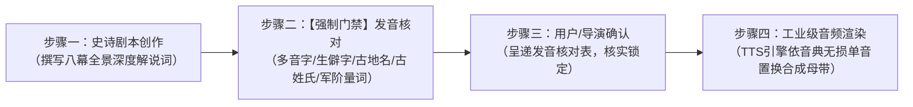

# hv-studio 史诗历史长视频工业级生产规范：发音核对前置门禁 SOP (Phonetic-First Gate Protocol)

> [!IMPORTANT]
> **最高铁律：核对在先，渲染在后！**
> 任何一集历史解说剧本，在启动任何 TTS 语音生成之前，**必须**首先执行自动化发音审计与人工核对清单确认，严禁未经核对直接进入音频渲染！

---

## 一、标准制作四步工作流 (Four-Stage Standard Pipeline)

---

## 二、发音审计六大高危专项清单 (Six High-Risk Phonetic Categories)

每集剧本创作完成后，必须通过 `phonetic_engine.py` 严格静态扫描以下六大类别：

1. **古代地名与政权**：
   - 例：`会稽`（必须锁死为 `Kuàijī / 快机`，绝不可读 `Huì jī`）
   - 例：`姑孰`（锁死 `gū shú / 姑熟`）、`吐蕃`（`tǔ bō / 土波`）、`吐谷浑`（`tǔ yù hún / 吐玉浑`）、`龟兹`（`qiū cí / 秋词`）
2. **历史人物姓氏与专名**：
   - 例：`任蛮奴`（古姓氏“任”读二声 `Rén / 人`）
   - 例：`贺若弼`（`bì / 必`）、`智顗`（`yǐ / 以`）、`萧摩诃`（`hē / 喝`）、`萧瑀`（`yǔ / 禹`）、`高颎`（`jiǒng / 炯`）
   - 例：`孔贵嫔`（`pín / 频`，严防误读为 `bìn`）
3. **军事战事与胜负多音字（降 xiáng vs jiàng）**：
   - 投降、降将、降服、纳降、出降、若降 → 统一置换为 `翔`
   - 天降、降临、降旨 → 保持 `降` 读 `jiàng`
4. **古代官职与军衔（将 jiàng vs jiāng）**：
   - 主将、大将、名将、老将、诸将、战将、将领、将士、将门、宿将、斩将、中郎将 → 统一置换为 `降` 读 `jiàng`
   - 将来、即将、将要、介词“将某物” → 保持 `将` 读 `jiāng`
5. **战马兵种与数量量词（骑 jì vs qí）**：
   - 单骑、轻骑、精骑、铁骑、万骑、数百骑、五百精骑、步骑 → 统一置换为 `记` 读 `jì`
   - 骑马、坐骑 → 保持 `骑` 读 `qí`
6. **经典文言通假与生僻字**：
   - `衣冠南渡` / `汉魏衣冠`（“冠”读平声 `guān / 关`，严防误读为 `guàn`）
   - `脔割`（`luán gē / 鸾割`，防止模型吞字）
   - `禅让` / `受禅`（`shàn / 善`）
   - `百万石`（`dàn / 担`）

---

## 三、门禁执行规范 (Gate Execution Standard)

1. **未核对，不启动**：生成脚本运行前，若检测到剧本未经过审计清单与词典同步，直接中断执行。
2. **词典集中沉淀**：所有通过核对确定的新词条，第一时间同步落盘写入 `D:\hv-studio\resource\pronunciation\global_phonetic_lexicon.json`，全剧集跨系列永久共享，杜绝二次踩坑。
3. **核对表可视化呈递**：在向用户汇报或进入音频工序前，必须在对话中清晰列出本集的核心核对清单。
