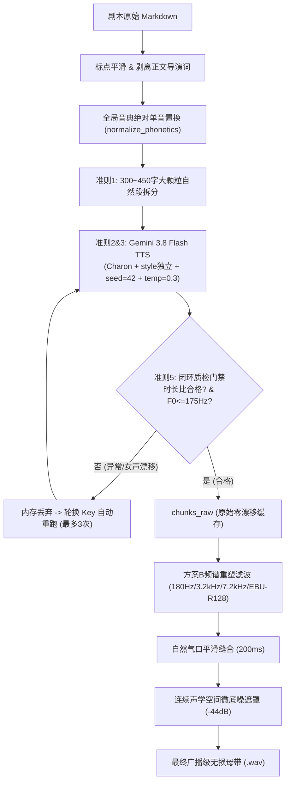

# 《hv-studio 工业级音频母带生产体系：方案 B+ 声纹闭环标准》
## Gemini 3.8 Flash TTS 万字长篇长剧本防漂移 5 大工程化准则

> **生效日期**：2026-11-16  
> **适用范围**：《风趣历史》、《盛唐大裂变》、《隋乱唐兴》、《千年科举》全系列及后续所有历史大长篇工程  
> **核心定位**：解决原生多模态音频模型（Native Multimodal Audio Generation）因自回归采样与长上下文诱发的“内部二次切片”、“声线漂移（Voice Drift）”、“中途女声变声”与“吞字/复读”缺陷。

---

### 一、五大工程化准则实施细则

#### 1. 控制单次切片安全粒度（300～450 汉字）
* **原理**：Gemini 音频生成模型单次请求若输入过长，会在模型底层触发**隐式内部二次切片（Internal Segment Boundaries）**并重新采样声学基线，导致段落内部突发变声或呼吸断层；
* **实施标准**：按自然段和标点严格拆分，单切片汉字严格控制在 **300～450 汉字**（约 60～100 秒音频）；
* **落盘函数**：`gemini_tts_engine.split_text_into_chunks(text, max_len=450)`。

#### 2. 锁定音色来源（Studio 静态预设 ID）
* **原理**：自然语言“文本捏声”（Voice Design）每次推理都会产生微小偏差，多切片拼接听感割裂；
* **实施标准**：100% 选用官方 Studio 预设音色 ID（历史解说统一绑定 `Charon` 沉稳男声），严禁动态生成音色描述变量；
* **配置参数**：`voiceConfig.prebuiltVoiceConfig.voiceName = "Charon"`。

#### 3. 风格元数据与随机种子硬死锁
* **原理**：剧本正文中的导演词（如“【语气：激昂】”）或感叹号会诱发自回归模型的“表演漂移”；高采样温度会导致各切片音高、语速离散；
* **实施标准**：
  * 正文台词彻底剔除所有语气、构图、镜头括号，平滑激烈标点；
  * 风格描述独立通过 `speechMetadata.style` 字段传参，且全集所有切片传入**一字不差的恒定字符串**：
    `"Calm, steady historical audiobook narrator, consistent deep pitch, authoritative timbre, natural pacing, clear articulation."`；
  * 锁定伪随机种子 `seed = 42`；
  * 降低采样温度至 `temperature = 0.3`。

#### 4. 多人分轨独立生成模式（单角色单轨制）
* **原理**：多 Speaker 混合长上下文会诱发模型“串音”与角色音色错乱；
* **实施标准**：旁白与不同角色对话拆分为独立生成任务，各自绑定独立固定 `voice` 与 `style`，最后通过 FFmpeg 插入 `0.3s～0.6s` 气口平滑对轨拼接。

#### 5. 时长比 + 声学基频 F0 闭环自动拦截与重试
* **原理**：偶发性声音漂移（Voice Drift）属于大模型底层特性，必须由代码级防御门禁在内存中拦截，绝不流入母带；
* **双重门禁指标**：
  1. **字数/时长比校验**：中文标准演播语速为 200~280 汉字/分钟。单段时长必须落在 `[字数/5.2, 字数/2.5]` 范围内，过短（吞字）或过长（复读/死循环）立即判定不合格；
  2. **声学基频 F0 校验**：基于 FFT 自相关提取未塑形原始音频基频，`Charon` 男声标准基频为 80~150 Hz。若检测到 F0 > 175 Hz（漂移成女声/高尖假声），立即判定不合格；
  3. **自动重试机制**：质检不合格在当前内存循环内自动 Rerun（最多 3 次，自动轮换 API 密钥），合格后方可写入磁盘缓存。

---

### 二、公共模块与调用范式

统一生产模块位于：`D:\hv-studio\tools\gemini_tts_engine.py`

```python
from gemini_tts_engine import (
    render_chunk_with_guardrail,
    split_text_into_chunks,
    smooth_punctuation
)
from audio_mastering_engine import (
    shape_chunk_audio,
    stitch_wav_sequence,
    apply_room_tone_masking
)
```

全流程流水线：

