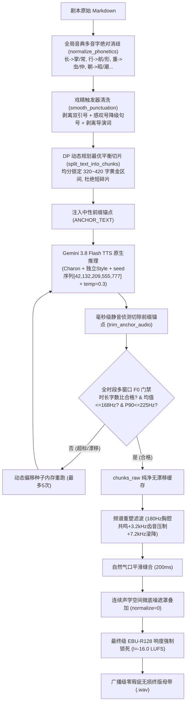

# 《hv-studio 工业级音频母带生产体系：方案 C 声学锚定与双门控生产标准》
## Gemini 3.8 Flash TTS 万字长篇长剧本防漂移与多音字消歧终极标准

> **生效日期**：2026-11-16  
> **适用范围**：《风趣历史》、《盛唐大裂变》、《隋乱唐兴》、《千年科举》全系列及后续所有历史大长篇工程  
> **核心定位**：解决原生多模态音频模型（Native Multimodal Audio Generation）因自回归 Token 预测产生的“前 1~2 秒冷启动语义劫持”、“戏精声线漂移（Voice Drift）”、“短文本高亢尖啸”以及“历史多音字读错（长/行/重/朝/更/将/乐/相）”等物理缺陷。

---

### 一、六大核心技术标准实施细则

#### 1. 固定前缀声学锚定与自动静音裁切（Prefix Acoustic Anchor）
* **物理机制**：自回归音频模型在前 1~2 秒最容易被剧本开头的剧情、惊叹号或人物情绪字眼劫持。在每个切片开头强行注入统一中性引导词，强迫模型每次都用一模一样的声带张力与初始音高起音。
* **锚点文案**：`ANCHOR_TEXT = "接下来，请听这一段内容。\n\n"`
* **裁切机制**：生成后在 1.0s ~ 3.5s 范围内自动通过 180ms 低能量窗口侦测静音气口并自动裁切前缀，输出纯净、起音浑厚（80~110Hz）的正文音频。

#### 2. 戏精触发器“硬核清洗”（Sanitization）
* **剥离双引号**：彻底正则剥离所有中文双引号 `“”`。模型一旦看到引号，极易自动切换成虚拟角色假声；
* **标点降噪**：所有感叹号 `！` 降级为平稳句号 `。`；连续波浪号/省略号降级为单逗号 `，`；
* **导演词剥离**：彻底剔除一切括号、语气词、镜头提示。

#### 3. 动态规划等分平衡分块（DP Balanced Chunking）
* **物理机制**：模型对 <250 字的短切片缺乏声学上下文，极易退化为 200~250Hz 的高亢发飘语调。
* **算法标准**：彻底废除贪婪分块。采用动态规划（DP）按目标大小 370 字进行全局均匀分割。**全剧任何一个切片均严格收敛在 320 ~ 420 汉字黄金区间，物理消灭一切短碎片。**

#### 4. 全时段滑动窗口基频 F0 监控与多元种子动态重抽
* **物理机制**：单点中值采样容易漏检片头（0~15s）和片尾的高频音色漂移；固定 seed 在大模型中具有确定性输出特征，重试若不换 seed 会导致死循环。
* **双重门禁指标**：
  1. **全时段滑动窗口 F0 扫描**：以 1.5s 窗口、0.75s 步长滑动扫描全切片。要求 90分位基频 $P90 \le 225.0\text{ Hz}$，且全切片均值 $\le 168.0\text{ Hz}$；
  2. **多元候选种子轮换序列**：`candidate_seeds = [42, 132, 209, 555, 777]`，拦截后自动在内存中偏移种子重试（最多 5 次），直至命中合格沉稳男声。

#### 5. 历史多音字上下文绝对单音置换专区（Polyphonic Disambiguation）
* **解决痛点**：多音字混淆是破坏长篇历史叙事沉浸感的第一大元凶（如“长子”误读为 cháng zǐ，“行伍”误读为 xíng wǔ）。
* **实施标准**：统一在 `global_phonetic_lexicon.json` 的 `polyphonic_disambiguation` 专区中录入成对高频词汇，无损替换为绝对唯一的单音字：
  * **长**：长子/长官/兄长/族长 -> `掌子/掌官/兄掌/族掌`；长治久安/长河/漫长 -> `常治久安/常河/漫常`；
  * **行**：行伍/行列/行业/同行 -> `航伍/航列/航业/同航`；颁行/推行/执行/品行 -> `颁形/推形/执形/品形`；
  * **重**：重申/重整/重围/重重 -> `虫申/虫整/虫围/虫虫`；重创/重任/重要 -> `仲疮/仲任/重要`；
  * **朝**：朝夕/朝令夕改 -> `昭夕/昭令夕改`；朝廷/隋朝/改朝换代 -> `朝廷/隋朝/改潮换代`；
  * **更**：更迭/更替/少不更事/三更 -> `耕迭/耕替/少不耕事/三耕`；
  * **将**：大将/名将/主将/将领/斩将 -> `大降/名降/主降/降领/斩降`；将军/将士 -> `将军/降士`；
  * **乐**：音乐/乐曲/乐府/礼乐/奏乐/配乐/乐声/乐队/乐师 -> `音月/月曲/月府/礼月/奏月/配月/月声/月队/月师`；快乐/欢乐/享乐/娱乐/乐趣/安居乐业/其乐融融/自得其乐 -> `快勒/欢勒/享勒/娱勒/勒趣/安居勒业/其勒融融/自得其勒`；
  * **调**：调动/调遣/调兵/声调/租庸调 -> `掉动/掉遣/掉兵/声掉/租庸掉`；调整/调节/调和/调解/风调雨顺 -> `迢整/迢节/迢和/迢解/风迢雨顺`；
  * **量**：衡量/丈量/商量/打量/量入为出 -> `衡粮/丈粮/商粮/打粮/粮入为出`；数量/力量/容量/胆量/气量/量力而行 -> `数亮/力亮/容亮/胆亮/气亮/亮力而形`；
  * **便**：便宜/大腹便便 -> `胼宜/大腹胼胼`；方便/便利/便宜行事 -> `方变/变利/变宜形事`；
  * **差**：差使/出差/听差 -> `柴使/出柴/听柴`；参差/参差不齐 -> `参疵/参疵不齐`；差距/差异/偏差 -> `叉距/叉异/偏叉`；差不多/差劲 -> `岔不多/岔劲`；
  * **禅**：登泰山封禅/封禅泰山/封禅大典/禅让/受禅/禅位 -> `登泰山封善/封善泰山/封善大典/善让/受善/善位`；禅师/高僧禅师/老禅师/禅房/禅院/参禅/坐禅/禅定/禅宗 -> `蝉师/高僧蝉师/老蝉师/蝉房/蝉院/参蝉/坐蝉/蝉定/蝉宗`；
  * **商贾**：商贾/富商大贾/商贾云集/多财善贾 -> `商古/富商大古/商古云集/多财善古`；
  * **星宿**：二十八宿/周天星宿/星宿/角宿/斗宿 -> `二十八秀/周天星秀/星秀/角秀/斗秀`；
  * **华山**：西岳华山/华山/华阴/华阴杨氏/华州 -> `西岳话山/话山/话阴/话阴杨氏/话州`；
  * **铁券**：金书铁券/免死铁券/铁券/契券/胜券在握 -> `金书铁劝/免死铁劝/铁劝/契劝/胜劝在握`；
  * **佛道专有**：般若/般若经 -> `波惹/波惹经`；南无阿弥陀佛 -> `那摩阿弥陀佛`；降妖除魔/降伏 -> `翔妖除魔/翔伏`；
  * **相**：宰相/丞相/拜相/将相/相权/相貌/真相 -> `宰向/丞向/拜向/降向/向权/向貌/真向`；互相/相助/相信 -> `互相/相助/乡信`；
  * **校**：校尉/校场/校检/校阅 -> `叫尉/叫场/叫检/叫阅`。

#### 6. 母带广播级终混响度铁律（修复 amix 衰减缺陷）
* **缺陷根因**：FFmpeg `amix` 默认将各路权重之和作为归一化分母，导致此前母带人声被无意识削弱 5.3 dB（实测仅 -21.3 LUFS）；
* **终极修正**：
  * 混音时关闭归一化：`amix=inputs=2:weights=1.0 0.03:normalize=0`；
  * 母带输出端强制追加最终级广播归一化：`loudnorm=I=-16:TP=-1.5:LRA=9`，**确保母带实测集成响度 100% 锁死在 `-16.0 LUFS` 国际标准**。

---

### 二、方案 C 工业全流程架构

